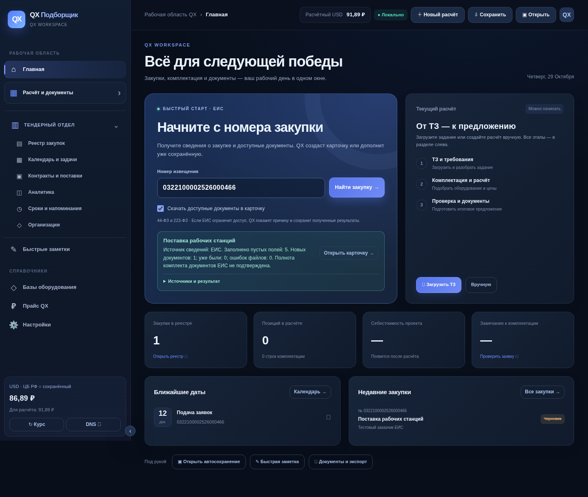

# QX Подборщик 4.0.40 DEV

Программа для работы с техническими заданиями, комплектацией оборудования, расчётами и закупками.

## Скачать

- [Обновление с 4.0.38 / 4.0.39 на 4.0.40 DEV](https://github.com/turistotwo-del/QX/raw/refs/heads/main/downloads/QX_Update_to_4.0.40_DEV.zip)
- [Полная Windows Portable 4.0.40 DEV](https://github.com/turistotwo-del/QX/raw/refs/heads/main/downloads/QX_Podborshchik_4.0.40_DEV_Windows_Portable.zip)
- [Контрольные суммы SHA-256](downloads/SHA256SUMS.txt)

Если прямая ссылка не начинает загрузку, откройте папку [downloads](downloads), выберите ZIP и нажмите **Download raw file** (значок скачивания).
Для закрытого репозитория необходимо войти в GitHub с доступом к нему.

## Обновление существующей программы

1. Полностью закройте QX и сделайте резервную копию тендерной базы через меню программы.
2. Скачайте архив обновления и распакуйте его.
3. Скопируйте содержимое папки `ОБНОВЛЕНИЕ_В_ПАПКУ_QX` в свою папку QX с заменой файлов.
4. Не удаляйте `.qx_runtime`, `QX_UserData` и данные QX в LocalAppData.
5. Запустите `ЗАПУСТИТЬ_QX.cmd`. Под логотипом проверьте версию 4.0.40; загрузчик теперь восстанавливает недостающие компоненты ЕИС.

Для новой установки распакуйте полный Portable-архив в отдельную папку и запустите `ЗАПУСТИТЬ_QX.cmd`.
Первый запуск требует интернета для установки Python и библиотек. Для окна программы необходим Microsoft Edge WebView2 Runtime.

## Что изменено в 4.0.40

Карточка сохраняется сразу, поиск работает фоном с этапами и доступом к уже созданной карточке.
ЕИС остаётся первым источником; при отсутствии сведений или файлов проверяется открытая карточка Контур.Закупок.
Исправлены cookies, реальные ссылки и имена документов. Добавлены проверки Portable-зависимостей и хранение RAR/7z оригиналами.

## Возможности

- Получение открытых сведений и доступных документов ЕИС по номеру закупки.
- Заполнение пустых полей с сохранением ручных значений и отчётом о расхождениях.
- Защита от повторного добавления идентичных документов.
- Передача сохранённого документа в расчёт как ТЗ.
- Сохранение оригиналов DOC, XLS и RTF для ручного просмотра.
- Новый главный экран с реальными закупками, датами и текущим расчётом.
- Раскрывающийся раздел слева «Расчёт и документы».
- Исправление сохранения быстрых правок и привязки расчёта к выбранному лоту.

## Проверки и ограничения

В Linux прошли 439 тестов, 113 дополнительных случаев и 14 сценариев Chromium. Проверены целостность ZIP,
запуск после распаковки и совпадение файлов обновления с полной версией.

Живой доступ к ЕИС в облаке был заблокирован прокси. Автоматические сетевые сценарии
проверялись на контролируемых ответах с настоящими API, SQLite и парсером документов.
ЕИС может ограничивать доступ; полнота получения сведений и документов не гарантируется.
Нативное окно, установка и обновление на Windows ещё требуют отдельной проверки.

Подробности: [отчёт проверок](QA_REPORT_4_0_40.md), [изменения](RELEASE_NOTES_4_0_40.md)
и [инструкция](ИНСТРУКЦИЯ_4_0_40.txt). Версия помечена **development**.

Исходники находятся в этом репозитории. Готовые архивы в `downloads` позволяют получить версию без Git и инструментов сборки.
